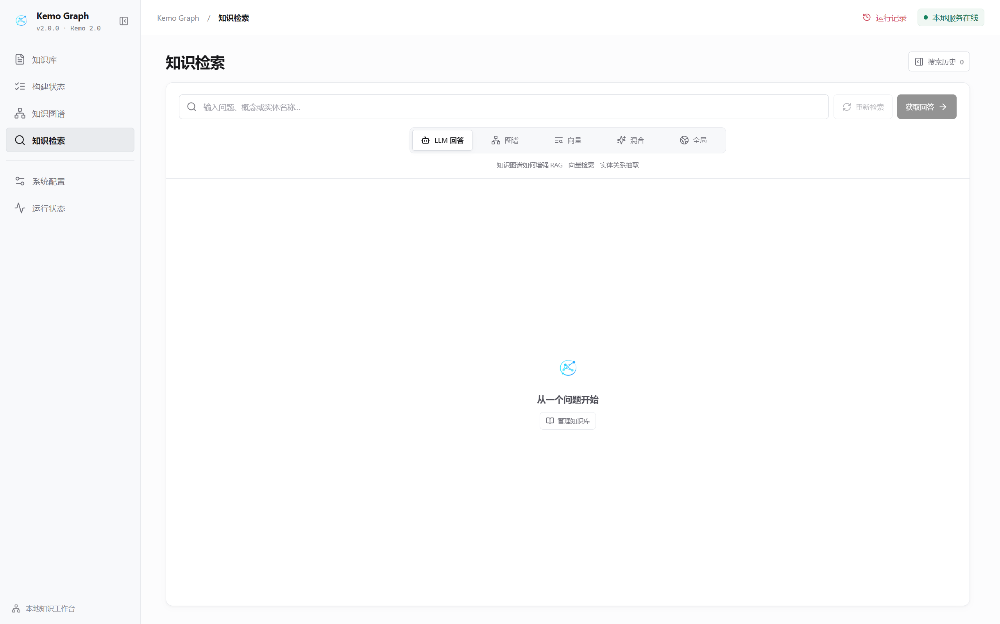

# kemo-graph

<p align="center">
  
</p>

<p align="center">
  <a href="README.md">简体中文</a> · <strong>English</strong>
</p>

<p align="center">
  <strong>Local knowledge graph and retrieval infrastructure for the Kemo ecosystem.</strong>
</p>

<p align="center">
  Turn multi-format materials into a traceable knowledge graph and vector index,<br>
  so agents can not only find the source text, but also understand concepts, relations, provenance and context.
</p>

<p align="center">
  <a href="version.yaml"></a>
  <a href="https://github.com/kesepain-KE/kemo-graph"></a>
  <a href="LICENSE"></a>
  <a href="api.md"></a>
</p>

---

## What if agents didn't have to guess from a pile of files

An agent that serves you over the long term will eventually run into the same problem.

Materials keep growing: project documents, course notes, design drafts, saved web pages, PDFs, Word files, spreadsheets and scattered records — all carefully kept. Yet when the agent actually needs to answer a question, it often ends up retrieving a few similar passages and guessing the context around them.

It may find "what was mentioned", but not necessarily: which concepts this one relates to; which documents support a given relation; which source a search result came from; or which knowledge is still trustworthy after files are updated or deleted.

**kemo-graph aims to be the layer in the Kemo ecosystem that handles exactly this.**

It ties raw materials, converted Markdown, graph nodes, relation evidence and text vectors into one maintainable chain. Agents no longer just "search for answers" in files — they can follow the knowledge structure to find relations, then return to the original text to confirm the evidence.

It is not another agent that chats. It is the knowledge layer that lets agents use, understand and maintain materials over the long term.

---

## What it does

| Scenario | Capability |
|---|---|
| Project knowledge accumulation | Connect design documents, notes and decision records into a queryable concept network |
| Agent knowledge collaboration | Let kemo-agent fetch graph relations and source evidence through the API on demand |
| Multi-format ingestion | Convert local PDF, Word, PowerPoint, Excel, email, text, tabular and structured-data files into Markdown |
| Source tracing | Every graph or retrieval hit can go back to its original document — no conclusion without evidence |
| Multiple retrieval modes | Graph, vector, hybrid, Q&A and global-topic search for different kinds of questions |
| Tunable extraction and robust recall | Fine/standard/coarse graph extraction profiles, query expansion, multi-query FAISS fusion and exact-term fallback for both semantic and short-keyword hits |
| Incremental maintenance | Only affected data is updated when files change, instead of rebuilding the whole knowledge base |
| Original-file library | Three resizable panes for real directories, original previews, text editing and moves; processed Markdown lives separately and maps back to each source |
| Visible processing | Dedicated build status, real query-stage progress and terminal/query/internal log tabs |
| Lower read overhead | Bounded memory caching for unchanged status, logs and knowledge-state fingerprints |
| Safe deletion | Shared sources are checked before deletion to avoid harming knowledge supported by other documents |
| Standalone deployment | Local Web, CLI and HTTP API, or as a knowledge backend for the wider Kemo ecosystem |

---

## Quick start

### Requirements

- Python 3.10+
- Node.js 18+ (needed to build the web frontend)
- Git
- An accessible Kemo gateway (kemo-adapter-api) with registered LLM, Embedding and Rerank models

### Get and run

Windows PowerShell example:

```powershell
git clone https://github.com/kesepain-KE/kemo-graph.git
cd kemo-graph

python -m venv .venv
.\.venv\Scripts\Activate.ps1
pip install -r requirements.txt

Copy-Item config\config.example.yaml config\config.yaml
```

At minimum, configure your gateway key in `config/config.yaml`:

```yaml
kemo:
  api_key: "your-kemo-gateway-key"
```

Application settings use UTF-8 YAML: `config/config.yaml` holds credentials, models, storage paths and `web.host` / `web.port` and is ignored by Git; `config/config.example.yaml` is the credential-free template, `config/logging.yaml` uses standard Python logging configuration, and `version.yaml` holds release metadata. Legacy JSON settings and `.env` are no longer loaded. Process environment variables may still override paths and Web binding or provide the gateway key. npm, TypeScript and Python build manifests retain their required JSON/TOML formats.

Graph extraction defaults to `large` (coarse) and can be adjusted in the Web “System settings” panel or `config/config.yaml` to `small` (fine), `medium` (standard), or `large` (coarse). Use `graph_extract_chunk_size` to tune the baseline section size. Coarse mode also applies per-section entity/relation budgets and puts details into summaries instead of creating graph fragments. Retrieval keeps the original query, adds bounded synonym/concept expansions, fuses multi-query candidates, and uses an exact-term fallback for short keywords and identifiers.

After changing the graph profile, the next scan marks completed documents as Graph-pending automatically. Run `python start.py rebuild-knowledge-base` to rebuild the graph without rebuilding unchanged RAG vectors.

Confirm the gateway address and models in `config/config.yaml`, then build the web frontend and start:

```powershell
cd web\frontend
npm install
npm run build
cd ..\..

python start_web.py
```

Open `http://127.0.0.1:8000`.

Linux/macOS terminals use the same application entry point:

```bash
git clone https://github.com/kesepain-KE/kemo-graph.git
cd kemo-graph
python3 -m venv .venv
source .venv/bin/activate
python -m pip install -r requirements.txt
cp config/config.example.yaml config/config.yaml
# Edit config/config.yaml for gateway, models, paths and Web binding
cd web/frontend
npm ci
npm run build
cd ../..
python start_web.py
```

---

## Basic usage

### Web

The browser provides original-file directory management, multi-format previews, text editing, dedicated build status, graph exploration, five retrieval modes, background task tracking, query-stage progress and runtime logs.

<p align="center">
  
</p>

<p align="center">
  <sub>A local-first knowledge retrieval workspace combining graph, vector, hybrid retrieval and LLM answers.</sub>
</p>

#### Original directories and processing mappings

The library has three resizable panes: the original-file directory tree, immediate children of the current directory with a relative breadcrumb, and the selected file's name, size, path and full preview. The page header contains search and refresh. The directory pane's `+` menu creates nested folders or documents and imports files into the selected directory. There are no built-in shared, user or project groups.

- Originals live in `external/originals/`; processed Markdown lives in `external/markdown/`. Custom Markdown directories use a sibling `originals/` directory.
- `sources.library_path` and `file_map.json` map each original to its processed artifact. Graph/RAG reads processed Markdown; retrieval and graph source links open the original.
- File menus rename, move, build or delete entries. Moves preserve source IDs, processed paths and existing indexes while updating source mappings, with no model calls. Importing different content under an occupied name returns a conflict.
- Refresh discovers additions, changes and deletions on disk. Refreshing and editing update processed artifacts without calling models; build a selected file or directory afterward.
- Deletion permanently removes originals, processed files and corresponding Graph/RAG data. Wait for background builds before relocating files.
- Portable Stores use `content/originals/` and `content/markdown/`, with `/api/v1/stores/library/{list,create,move,delete,refresh}` and `store_root` in the JSON body.

Files retained only as processed Markdown by older versions are not presented as originals. Reimport the original materials for native-format previews; existing indexes and processed files remain on disk. The previous project-organization API has been removed.

#### Query progress

Short labels show stages actually executed by the current query: LLM optimization, keyword/subquery processing, query embedding, graph/vector/lexical recall, chunk aggregation, reranking and answer generation. Skipped work is not marked completed; cache hits and planner fallback are identified separately. Internal navigation does not interrupt a query; reloading or closing the page does not preserve its waiting state.

Document chunking and document embedding belong to ingestion. Retrieval processes questions and existing chunks, without rebuilding documents just to show progress. Live stages use bounded, short-lived process memory, with no extra model calls or disk progress log. Multi-worker deployments require query and progress requests to reach the same worker; otherwise only that worker's confirmed stages are available.

#### Build status

**Build Status** has compact pipeline summaries above a document queue and a processed-Markdown panel. Click RAG / Graph status counts to combine filters. The top-right actions are retry failed builds, search, and refresh. Each document card shows both pipelines; expand it for real completed steps, the exact failure and error, a link to the original, and a single-document rebuild. Sources without step history show no fabricated progress.

The right panel previews and edits the separate processed Markdown, with file size and original/processed paths. Save without building, or save and rebuild both pipelines for that file. Originals are never changed; existing indexes remain available until replaced. Bulk retry runs only failed pipelines, not unrelated pending work. Browse six documents per page with independent panel scrolling and optional five-second refresh. Leaving the page does not interrupt background builds.

#### Runtime status and logs

The Runtime Status page includes a log card with **Terminal startup**, **Queries**, and **Internal events** tabs. Select a UTC date, refresh manually or every five seconds, and optionally follow the newest entries. Logs scroll inside the card.

Persisted and console logs use TSV tables with six fixed columns: `time`, `level`, `module`, `action`, `detail`, and `elapsed_ms`. The Web viewer displays the same columns with sticky headings, wrapped details and internal horizontal scrolling on narrow screens. Restart helper logs are stored in `update/runtime/restart.tsv`.

Terminal logging starts after the upgraded service restarts and covers Web lifecycle events and Python/Uvicorn logging; previous shell output and arbitrary third-party stdout are not captured. Query lifecycle events include a `query_id`, outcome and duration, without newly recording question bodies or model answers. The viewer shows up to 200 entries and reads at most the final 2 MB of the selected daily log. API keys, Bearer tokens and other credential patterns are redacted.

#### In-memory read cache

Long-running Web/API processes share a bounded read-through cache for knowledge-state fingerprints, document pages, runtime status (including FAISS health results), logs, configuration text and the query-planning prompt digest. This supplements, rather than replaces, the existing SQLite search-result cache; forced queries, history cleanup and database writes retain their behavior.

- Limits per process: 256 entries, 32 MiB of serialized payload, and 2 MiB per entry. These are cache-payload limits, not a cap on total process memory. Least-recently-used entries are evicted; oversized values are not retained.
- Reads check file identity, size and timestamps, plus the 100-byte SQLite header. Normal commits, renames, deletions and database replacements invalidate affected reads. Even unchanged entries expire after 30 seconds.
- Database caching is bypassed while a nonempty WAL or transaction journal exists. No long-lived database connections are retained, allowing rebuilds to replace files.
- Concurrent reads for the same data share a load; callers receive independent values. Failed reads are not cached. Log-cache keys also reflect the credentials used for redaction.
- Absolute Store paths isolate entries. Each process has its own cache, empty after restart; one-shot CLI processes benefit only within that invocation. Database and log writes remain synchronous with their existing paths; no delayed-write buffer is introduced.

#### Knowledge-document preview and rendering

The preview reads originals directly. Word, PDF and PowerPoint use the Apache-2.0 File Viewer React component and matching renderers, with Mozilla PDF.js powering PDF rendering. The official Vite plugin bundles the workers, WASM and fonts into `dist/assets/file-viewer` for deployment with the application. Previewing requires no desktop Office or LibreOffice installation, public CDN, or third-party document upload. Documents and slides retain their layout; special fonts, animations and complex Office features can still differ from desktop applications.

Images display directly; XLS/XLSX/XLSM previews include every worksheet, with EPUB, RTF, EML and sandboxed HTML also supported. Binary originals remain downloadable for local editing. Original previews remain independent of the Markdown indexing pipeline. Expanded previews occupy approximately 84% of viewport width and 90% of viewport height; clicking the surrounding overlay closes them.

Markdown preview reads the original `.md` / `.markdown` file. It uses `react-markdown`, GFM, KaTeX and a Mermaid renderer loaded on demand. Supported features include:

- headings, bold, italic, strikethrough, nested lists, task lists, block quotes, thematic breaks, tables, footnotes, links, images and fenced code;
- inline math such as `$a^2+b^2=c^2$` and display math with `$$...$$`;
- common LaTeX wrappers `\(...\)` and `\[...\]`, plus `aligned`, `cases`, matrices, fractions, integrals, sums, limits, Chinese `\text{}` and `\xrightarrow{}`;
- language-aware code highlighting;
- Mermaid fenced blocks, for example:

  ````markdown
  ```mermaid
  flowchart TD
      A[Source] --> B[Markdown]
      B --> C[Knowledge graph]
      B --> D[RAG vectors]
  ```
  ````

- Obsidian-style links: `[[Data structures]]` and `[[Data structures|open the concept]]`;
- Obsidian-style callouts:

  ```markdown
  > [!NOTE] Note
  > This body is rendered as a themed information panel.
  ```

- safe placeholder rendering for `![[document or image]]` embeds;
- YAML/TOML frontmatter recognition, hidden from the normal reading flow.

Math is rendered with KaTeX. Wide matrices and long formulas scroll inside the document preview instead of breaking the surrounding card. Mermaid is dynamically loaded only when a document contains a diagram, so ordinary documents do not pay the chart-engine startup cost.

Raw HTML and `<script>` are intentionally not executed, preventing imported documents from becoming script-injection surfaces. Web pages, video, audio, OCR and remote links should still be normalized by the upstream agent before they reach kemo-graph. Unsupported custom KaTeX macros are kept as source with a localized error indicator; they do not blank the whole document.

### Command line

```powershell
# Convert to Markdown only; no knowledge-base initialization or model call
python -m markitdown $env:KEMO_GRAPH_IMPORT_FILE -o output.md
python convert.py $env:KEMO_GRAPH_IMPORT_FILE -o output.md

# Import a file (without spending model quota yet)
python start.py import $env:KEMO_GRAPH_IMPORT_FILE --no-ingest

# Scan and ingest all pending documents
python start.py ingest

# Query
python start.py query-hybrid "how does a knowledge graph improve retrieval"
python start.py query-answer "answer based on both graph and source text"

# Sync authoritative kemo-agent table records into their independent Store
python start.py --store-root $env:KEMO_GRAPH_STORE_ROOT source-sync records.json

# Status and maintenance
python start.py status
python start.py list-docs
python start.py organize-graph
python start.py rebuild-all

# Check and apply updates
python start.py update-check
python start.py update

# Root updater: asks whether to force a refresh when versions are identical
python update.py
```

The normalization layer handles local ordinary files only. Web crawling, video, audio, OCR and remote links should be handled by the upstream agent before it passes Markdown or a local file to kemo-graph; the converter never accesses the network.

### HTTP API

kemo-graph can run as a standalone service, exposing graph query, hybrid retrieval, import and maintenance endpoints to agents such as kemo-agent:

```powershell
uvicorn api:app --host 127.0.0.1 --port 8000
```

The full request fields, response envelope and error codes are defined in [api.md](api.md).

---

## Data and privacy

- Originals, processed Markdown, graphs and indexes stay in your local working directory. Local materials use originals as their source; Graph/RAG reads separate processing artifacts. Externally synchronized records retain their upstream authority.
- Graph building, Embedding and Rerank call models through the Kemo gateway; before processing sensitive materials, review your gateway, model and network boundaries.
- Application query-lifecycle logs do not additionally retain question bodies or model answers. The viewer redacts known secrets and common authentication fields; third-party Python logs can still contain business information, so protect log and service access.

> **Note**: the external API has no built-in application-level authentication. It should only listen on `127.0.0.1` by default; for cross-device or public access, put a VPN, reverse proxy, TLS or authentication layer in front. Never expose an unprotected port directly.

---

## What we want it to become

kemo-graph does not try to replace every file manager, every database, or every search system.

It aims to be a stable knowledge foundation in the Kemo ecosystem: materials keep their provenance once they enter the system; relations can be discovered without drifting from source evidence; when files change, the system knows what to update and what to keep; models and providers may change, but the local source of truth stays in your hands.

An agent that truly accompanies a long-lived project should not only have a longer context window — it should also have a knowledge foundation that can keep understanding materials, verifying sources and maintaining structure.

---

## Current status

The core loop is already runnable: unified import, incremental updates, graph and vector retrieval, hybrid Q&A, safe deletion, scheduled maintenance, plus three entry points (Web, CLI, HTTP API) and an external knowledge-service interface for agents such as kemo-agent.

The current release is **2.0.0**. The library manages original documents through their real filesystem paths and maintains processed files through a separate mapping. Background Graph/RAG jobs provide per-document progress, failed-task retries, and processed-document editing. Graph and full-text search share tokenization and retrieval capabilities, alongside an updated web workspace. The conversion layer unifies error semantics and registered format capabilities and recognizes extensionless files by content. Original-file previews remain independent of indexing conversion; processed output still excludes binary image payloads, Data URIs, scripts, and styles.

Recognized grid tables in PDFs are retained as Markdown tables, with surrounding prose preserved and table-free pages unchanged. DOCM and PPTM content reading joins existing XLSM support without executing VBA. DOCM requires Mammoth and markdownify and never falls back to python-docx. See the [conversion-layer guide](markitdown/README.md) for supported formats, dependencies and limits.

See [CHANGELOG.md](CHANGELOG.md) for the release summary, upgrade notes and verification commands. The root `version.yaml` is the application-version source; frontend and converter-package release metadata share the same version. This release includes the Kemo 2.0 Provider adaptation and keeps kemo-graph's own HTTP routes under `/api/v1`.

Still being polished: conversion quality for complex document layouts, storage and index strategy for large knowledge bases and high concurrency, built-in authentication and permission tiers for the external API, and richer manual graph correction and provenance review interfaces.

If you are trying this early version, bug reports, retrieval feedback, sample document formats, and real scenarios of how you want agents to use a knowledge base are all welcome.

---

## Related Kemo ecosystem projects

- [kemo-agent](https://github.com/kesepain-KE/kemo-agent) — a local multi-user Agent Runtime for personal AI infrastructure; it can use kemo-graph's graph and RAG knowledge through the API.
- [kemo-adapter-api](https://github.com/kesepain-KE/kemo-adapter-api) — the unified Kemo model gateway, providing LLM, Embedding and Rerank models to ecosystem components over one protocol.

Each project can be used independently, or together as one local AI infrastructure where each plays its own role.

---

## Maintainer

[@kesepain](https://github.com/kesepain-KE)

---

## Contributing

kemo-graph is still in early development. Bug reports, format samples, retrieval quality feedback, documentation improvements and feature contributions are all welcome.

Suggested flow: Fork this repository → create a feature branch → make your changes and run the necessary tests → open a Pull Request explaining what changed, why, and how it was verified.

---

### Backend development entry points

Use `from core import KnowledgeBaseService` or import it from `core.service`. Configuration and storage live in `core.settings` and `core.storage`; graph, RAG, ingestion and maintenance live in their corresponding domain packages. Legacy flat-module compatibility imports have been removed. API routes and models now live in `api/routes/` and `api/schemas/`, with the HTTP contract preserved.

Run `python tools/check_architecture.py` and `python -m pytest tests/ -q`. See [core service boundaries](core/service/README.md) for dependency layers and export rules.

---

## License

This project is open-sourced under the [Apache License 2.0](LICENSE).
