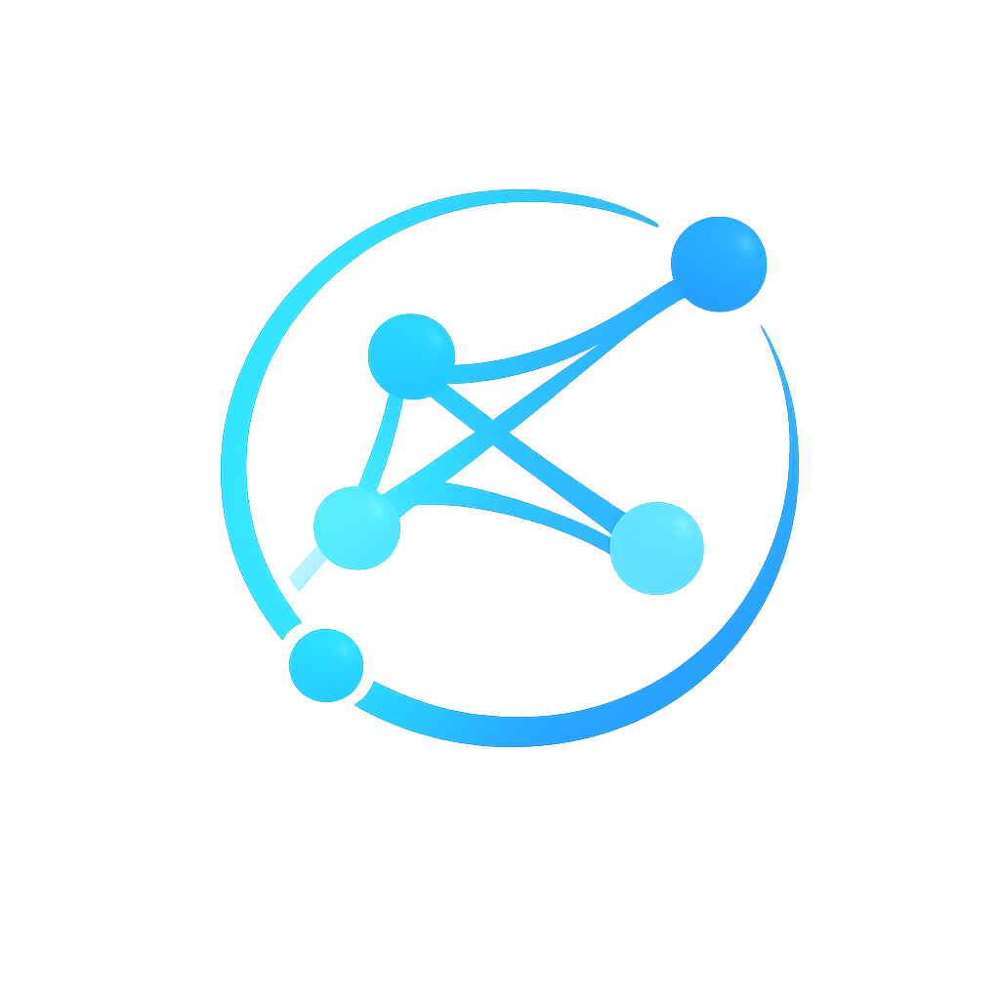

# kemo-graph

  

  <a href="README.md">简体中文</a> · <strong>English</strong>

  <strong>Local graph and retrieval infrastructure for the Kemo ecosystem.</strong>

  Turn heterogeneous documents into a traceable knowledge graph and vector index, 
  so agents find not only the source text but also the concepts, relations and context.

  
  
  

---

## What it does for agents

kemo-graph is not another chat agent. It is **the knowledge layer agents run on**: original documents, normalized Markdown, graph nodes, relation evidence and text vectors, all on one maintainable chain.

| What an agent needs | What kemo-graph provides |
|---|---|
| Find the material | Document listing, source reading, directory tree browsing, full-text and vector retrieval |
| Know how concepts relate | Graph nodes and edges, one-hop relations and multi-hop paths, deterministic BFS neighborhoods |
| Get an answer with evidence | Hybrid retrieval Q&A: graph paths + source chunks + entity and community context handed to the model |
| Judge whether evidence holds | Every relation keeps source bindings and evidence weight; retrieval hits trace back to originals |
| Stay correct after changes | Incremental maintenance: only affected data is rebuilt; deletion checks shared sources first |
| Save tokens in a limited context | Five retrieval modes chosen per task; fetch structure first, then text, instead of pasting whole files |

The current release is **2.0.0**.

## How agents operate it

External agents (kemo-agent or any other framework) drive this service over HTTP, with no dependency on a specific agent client.

**Operation guide entry: [`agent/README.md`](agent/README.md)**

The directory is split by task: connection and service boundaries, retrieval and Q&A, documents and directories, graph reading and writing, build and maintenance, endpoint reference. Read the connection guide first, then only the page for the current task.

Request fields, response shapes and error codes live in [`api.md`](api.md).

## Related Kemo projects

- [kemo-agent](https://github.com/kesepain-KE/kemo-agent) — Local multi-user agent runtime for personal intelligence infrastructure; uses kemo-graph API for graph and RAG knowledge.
- [kemo-adapter-api](https://github.com/kesepain-KE/kemo-adapter-api) — Unified model gateway exposing LLM, embedding and rerank models to ecosystem components over one protocol.

They can be used independently or together as parts of one local intelligence infrastructure.

---

## License

Licensed under the [Apache License 2.0](LICENSE).
